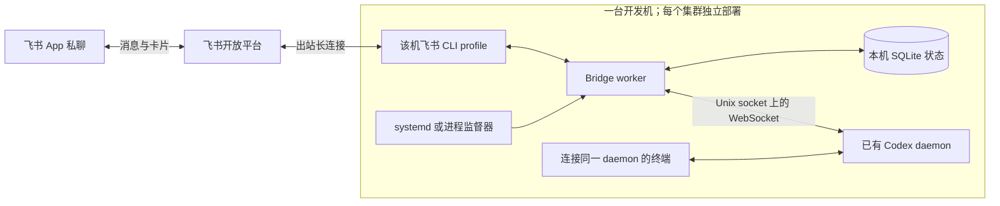

# Codex Feishu Bridge

通过飞书私聊选择开发机上的**已有 Codex 会话**、查看最新进展、发送指令、补充运行中
任务并处理支持的审批。每台开发机独立运行一个 worker，复用该机的飞书 CLI profile
和 Codex 登录；运行期间无需 Mac、SSH 隧道或公网入站端口。

当前是可构建、可测试的初版。真实开发机部署、飞书权限和端到端收发需要按机器分别
验收；仓库中的测试通过不代表三台集群都已部署完成。

## 已实现的交互

| 在飞书里做什么 | 行为 |
| --- | --- |
| `/dirs` | 列出授权目录内已有会话涉及的目录，提供选择按钮。 |
| `/sessions [完整目录]` | 按目录查看会话，显示名称、工作目录、ID 和状态；支持翻页。 |
| `/select <完整会话ID>` | 载入既有会话，沿用其工作目录、模型和权限。 |
| 直接发送文字 | 空闲时开始下一轮；运行中使用当前 turn ID 补充指令。 |
| `/status` | 查看最新两轮历史中最近一轮的可见回复和工具状态；状态卡默认每 10 秒刷新。 |
| `/interrupt` | 请求中断当前轮次；旧会话的状态卡不能中断新选中的会话。 |
| 审批按钮、问答按钮 | 处理命令执行、文件变更的单次批准/拒绝，以及结构化用户问答。 |
| `/unbind`、`/health`、`/help` | 取消绑定、查看健康状态、打开菜单。 |

长回复按 UTF-8 字节拆成多张卡片，代码块跨卡片时补齐围栏。SQLite 保存会话绑定、
消息去重、审批状态及待发送卡片；发送失败会退避重试。模型指令提交后失去回执时会
标记“结果需核对”，不会在重启后自动重新执行。

## 架构



`dev-a`、`dev-c`、`dev-b` 各自使用独立配置、状态目录和飞书应用/profile。
切换飞书应用就是切换机器，再从该应用内选择目录和会话。初版没有一个机器人统一
跨集群调度的中央服务。

## 快速开始

在目标开发机准备 Node.js **22.13+**、已登录且支持 `event consume` 的飞书 CLI，
以及运行中的 Codex daemon。共享会话必须使用该 daemon 的真实 Unix socket。
开发机上的全局 Node 可能过旧，服务配置应使用已核验的 Node 绝对路径。

```sh
npm ci
npm run build
npm test
python3 -m unittest discover -s deploy -p 'test_*.py'
cp config.example.json config.local.json
chmod 600 config.local.json
```

编辑 `config.local.json` 后运行：

```sh
npm start -- --config /absolute/path/config.local.json --check-config
npm start -- --config /absolute/path/config.local.json --doctor
npm start -- --config /absolute/path/config.local.json
```

`--check-config` 只检查配置；`--doctor` 检查飞书 CLI 版本与 Codex 只读协议连接，
**不验证飞书消息权限、按钮回调或真实投递**。持续运行请选择
[运维说明](docs/operations.md)中的监督方式，不依赖一个开着的 SSH 终端。

关键配置：

- `host`：例如 `dev-a`，用于卡片标识。
- `allowedUsers`：只填允许操作者的真实飞书 `open_id`。样例中的
  `ou_REPLACE_WITH_YOUR_OPEN_ID` 是有意不能通过校验的占位符，必须替换。
- `allowedRoots`：现存的绝对目录。会话工作目录必须位于这些真实路径内，符号链接
  和 `../` 不会绕过范围检查。
- `stateDir`：该机独占、用户私有的**本地持久文件系统**目录；优先已核验的本地
  XFS/ext4。SQLite WAL 状态库不要放在 GPFS/NFS 或未经验证的跨主机共享挂载上。
  代码和配置可以保存在集群持久卷，但这不代表该卷适合运行 SQLite WAL。
- `lark.binary/profile/cwd`：已有飞书 CLI 的路径、已配置 profile，以及必要时用于
  查找已有工作区配置的目录；不把应用密钥写入仓库。
- `codex.socketPath`：已有 daemon 的绝对 Unix socket 路径，使用直接 WebSocket
  传输；共享模式的 `codex.args` 设为空数组。`codex.binary` 保留为配置中的明确
  Codex 路径，不借此启动或重启共享 daemon。
- `pollIntervalMs`：默认 `10000`，不得小于 `1000`。

**不要把 `codex app-server proxy` 的原始字节当作 JSONL。** dev-a 的 daemon
0.165.0 已只读核验使用 HTTP WebSocket Upgrade 和 WebSocket 帧。
`codex app-server --stdio` 的逐行 JSON 仅适用于明确选择的独立进程模式；它不能
替代共享 daemon 来接管另一终端正在持有写锁的会话。

## 飞书应用配置

复用每台机器的现有自建应用与 bot 身份，限制到指定操作者和所需项目目录。
当前文本私聊链路需要：

1. 开启机器人能力，操作者在应用可用范围内。
2. 核对私聊消息接收 `im:message.p2p_msg:readonly`、机器人发消息
   `im:message:send_as_bot`，以及当前 CLI 卡片回调消费者要求的
   `im:message:readonly`。以实际 CLI 的 `missing_scopes` 和开放平台权限要求为准。
3. 在事件配置中订阅 `im.message.receive_v1`，在回调配置中订阅
   `card.action.trigger`，使用长连接模式。
4. **发布包含权限与订阅变更的应用版本**，并完成所在组织要求的审核。

成功发送一张卡片不代表按钮回调已生效。该桥接不自动扩大权限、不自动登录用户
OAuth，也不需要为尚未实现的群聊、通讯录或附件功能申请额外权限。
参考：[飞书机器人权限说明](https://open.feishu.cn/document/develop-robots/add-bot-to-external-group)、
[官方回调概述](https://open.feishu.cn/document/event-subscription-guide/callback-subscription/callback-overview)。

## 当前边界

- 支持**私聊文本和本服务发出的按钮**；群聊、图片/文件/语音附件尚不支持。
- 只选择已有 session，尚未实现从飞书创建新 session、任意修改模型或配置。
- 一个会话只绑定一个控制对话与操作者；不能让不同聊天同时争用同一会话的审批。
- 同一个正在运行的会话要求客户端连接同一 daemon。被独立终端或另一 app-server
  持有的会话不能强行接管；不会终止现有进程来绕过写锁。
- 命令/文件审批和用户问答已实现。其他 MCP、动态工具或权限请求会明确提示未支持，
  必须在连接同一 daemon 的终端处理；不会自动批准或伪造回答。
- 提供会话操作的语义交互，不复制终端像素 UI，也不提供任意交互式 shell/TUI。
- 状态卡按事件与轮询更新，最终回复完整分卡片展示；不是完整的逐字 CardKit 流式
  渲染，也不是整段历史自动同步。
- 监督器能恢复 worker 进程故障；机器/容器重建后恢复还需要平台启动 hook、可用的
  持久数据以及 Codex daemon 恢复。尚未配置并验证这些条件时，不承诺重建自动恢复。

## 开源复用与验证

交互功能参考直接桥接类热门项目 [cc-connect](https://github.com/chenhg5/cc-connect)。
实际卡片构建复用[飞书官方 OpenClaw 插件](https://github.com/larksuite/openclaw-lark)
固定版本的 MIT 纯函数子集，未引入整个 OpenClaw 运行时。
热度、许可核验和取舍见[选型记录](docs/open-source-selection.md)；代码改编和版权见
[第三方声明](THIRD_PARTY_NOTICES.md)及[随附 MIT 许可证](vendor/openclaw-lark/LICENSE)。

自动测试覆盖传输握手、事件解析、命令去重、审批绑定、重启恢复、并发卡片更新和
故障退避。真实运行的验收方法、存储要求和故障处置见
[运维说明](docs/operations.md)，协议差异见[Codex 协议说明](docs/codex-protocol.md)。
